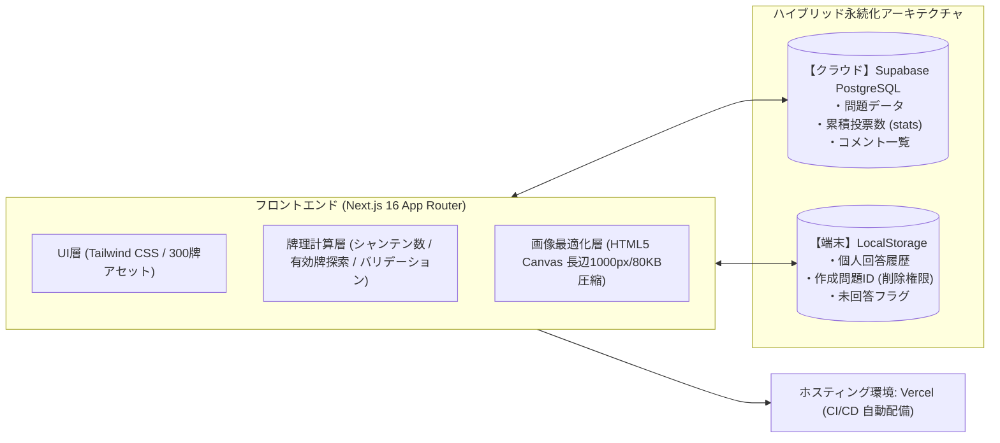
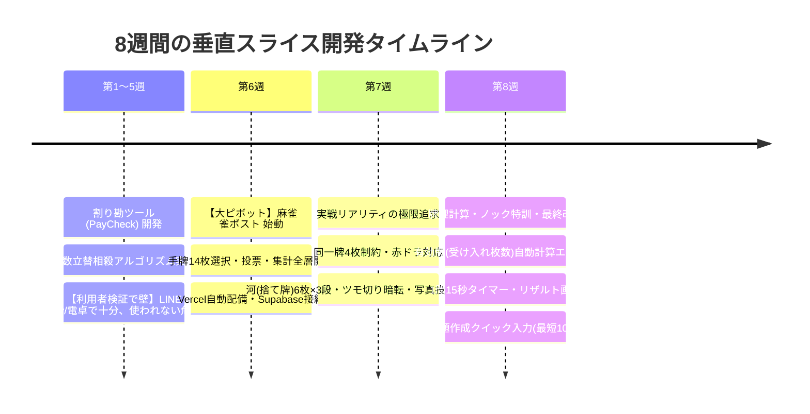

# ソフトウェアクリエイション1 最終制作レポート

**提出日**：2026年11月17日  
**担当グループ・座席番号**：後半・B41  
**学籍番号**：XXXXXXX  
**氏名**：受講生氏名  

---

## 1. プロダクト基本情報
- **プロダクト名称**：雀ポスト（JanPost）
- **本番公開環境URL**：[https://janpost-sayu.vercel.app/](https://janpost-sayu.vercel.app/)
- **ソースコードリポジトリURL**：[https://github.com/taisei0621/janpost](https://github.com/taisei0621/janpost)

---

## 2. 解決すべき課題と対象利用者（要求の原点）

### 対象とする単一の利用者（N=1）
麻雀の実戦対局において「この局面、何を切るべきだったか」「他家の捨て牌を鳴くべきだったか」に日々悩み、客観的な意見や統計を求めてSNS（X/旧Twitter）や知人に相談している開発者自身、および日常的に戦術議論を行う雀士仲間。

### 切実な不便と従来の代替手段の限界
麻雀の「何切る」は全国数百万人の雀士の間で最も熱狂的に議論されるコンテンツであるが、既存の代替手段には以下の決定的な構造的欠陥が存在していた。

1. **X（旧Twitter）アンケートの「4択の限界」と意見の散乱**：
   麻雀の手牌は14枚存在するにもかかわらず、Xの投票機能は「最大4択」に制限されている。そのため、出題者が勝手に絞った4枚からしか選べず、回答者の真の思考が奪われていた。また、リプライ欄に各雀士の持論が散乱するため、「結局みんなが何を切ったのかという客観的な統計分布」が集約・可視化されないという強いストレスがあった。
2. **2000年代の古い掲示板型サイトの限界**：
   既存の老舗何切るWebサイト（nnkr.jp等）はPC時代の古い掲示板システムで止まっており、スマートフォンでの操作性が極端に悪く、難問奇問が無秩序に乱立しているため、初級者〜上級者が段階的に学べるステップアップ環境が存在しなかった。

### 提供する中核的価値
**手牌14枚の中から1タップで直感的に捨て牌を選択でき、即座に「全国の打牌分布グラフ」「有効牌枚数（受け入れ枚数の差）の精密自動計算」「打牌理由の集合知」が可視化される、登録不要・摩擦ゼロのステップアップ型何切るプラットフォーム。**  
URLを共有するだけで、相手にアカウント登録を一切要求せず、誰でも1秒で回答に参加できる体験を提供する。

---

## 3. プロダクトの機能概要・使い方・システム構成

### 主要機能と使い方

```
【利用者の基本操作フロー】
[URLを開く (ログイン不要)] 
   │
   ├─► ①【回答モード】手牌14枚から切りたい牌を1タップ選択 
   │      └─► 即座に「打牌分布グラフ」「有効牌差（+〇枚有利）」「理由コメント一覧」が開示
   │
   ├─► ②【特訓モード】「🎲 何切るノック」を起動
   │      └─► 1問15秒のタイマー制限で即断即決トレーニング ➔ 終了時に正答率・連勝称号を表示
   │
   └─► ③【出題モード】「📮 問題を投函する」を起動
          ├─► 牌パレット作成：🎲ランダム手牌やテンプレートから最短10秒で投函
          └─► 写真・スクショ投稿：対局画面1枚（自動80KB圧縮）で手軽に即出題
```

1. **手牌14枚完全自由選択 ＆ リアルタイム打牌統計・理由の可視化**：
   出題された局面に対し、14枚の手牌（または写真）から直感的に打牌を選択。投票と同時に全国の雀士の選択比率バーグラフが開き、各打牌に添えられた「打牌理由」が一覧化される。
2. **シャンテン数・有効牌（受け入れ枚数）の精密動的計算エンジン**：
   手牌・ドラ表示牌・4家の河（捨て牌）・鳴き牌から見えている牌を動的に差し引き、山に残っている実質的な有効牌枚数を算出。選んだ打牌と正解打牌の差（例:「打4sの方が有効牌が+6枚有利」）を数学的根拠として提示。
3. **一体型雀卓マット全景ビュー（トップダウン盤面）**：
   競技麻雀正式の「6枚切り×3段」の河を再現。手出し牌とツモ切り牌（半透明薄暗い表示）を視覚的に区別し、リーチ宣言牌（90度横向き）や供託1000点棒を配備した実戦盤面を提供。
4. **他家の捨て牌をどう鳴くかを問う「鳴くか問題」**：
   他家からの打牌に対し、「34mでチーして打1m（本命）」vs「13mでカンチャンチーして打4m（妥協）」vs「スルー」など、鳴く組み合わせと鳴いた後の打牌まで問える新形式に対応。
5. **1問15秒タイマー付き「何切るノック（特訓モード）」**：
   ランダムに1問ずつ出題され、15秒以内に即断即決で解答する特訓機能。過去に解いた問題も毎回未回答状態でフレッシュに出題され、途中で終了しても正答率・連勝記録・認定称号が表示される。
6. **クイック問題作成（最短10秒投函）＆ 写真自動圧縮投稿**：
   手動で14枚選ぶ手間を排す「🎲 ランダム手牌セット」「定番形テンプレート」を完備。また、雀魂・天鳳・MリーグのスクショをCanvasで約80KBに自動圧縮して即投稿できるパイプラインを実装。

### 採用した技術スタックとアーキテクチャ構成



| レイヤー | 採用技術 | 選定理由 |
| :--- | :--- | :--- |
| **フロントエンド** | Next.js 16.4.5 (App Router), TypeScript, Tailwind CSS | 麻雀牌コンポーネントの宣言的UI構築、厳格な型安全性による回帰バグ抑止、スマホネイティブアプリ並みの軽快なレスポンス。 |
| **バックエンド / DB** | Supabase (PostgreSQL) | サーバーレス運用による管理コストゼロ化。全国の打牌数集計（`stats`）およびコメント・いいねデータのリアルタイム一元管理。 |
| **端末内ストレージ** | ブラウザ LocalStorage | **ログイン不要（アカウント登録ゼロ）の実現**。個人の回答履歴（「📮 回答済」スタンプ）や自端末作成問題の削除権限を端末内で安全に完結。 |
| **ホスティング** | Vercel | GitHubリポジトリ連携による完全自動CI/CD、高速CDNエッジ配信。 |

---

## 4. 8週間の垂直スライス開発とフィードバックによる改善の軌跡

### 週次イテレーションの歩み



- **第1〜5週（前テーマ：割り勘ツール PayCheck）**：
  複数人の立替を相殺するグラフ理論アルゴリズムやレシート画像圧縮を実装。しかし利用者テストを通じて「LINE Payや電卓で十分であり、わざわざ専用Webアプリを開く動機がない」という根本的課題に直面。
- **第6週（アジャイルの原点に立ち返った完全ピボット）**：
  過去5週分のコード資産への未練を完全に断ち切り、未解決の強いペインが存在する「麻雀のリアルタイム何切るプラットフォーム」へ180度ピボット。手牌14枚からの1タップ打牌選択、Supabase連携、回答分布グラフ表示を1週間で全層貫通。
- **第7週（競技性の追求と実戦盤面の多次元モデリング）**：
  同一牌最大4枚制約、赤ドラ（0m, 0p, 0s）の合算管理、上級者の押し引きを可能にする「6枚×3段の河」「手出し vs ツモ切り薄暗い表示」、対局スクショを長辺1000px・80KBに圧縮して即出題するクライアント側Canvasパイプラインを統合。
- **第8週（麻雀牌理エンジンの自前実装と機能完成）**：
  面子手・七対子・国士無双のシャンテン数探索アルゴリズムを自前実装し、卓上の見え牌を引いた「実質有効牌枚数（受け入れ枚数）」のリアルタイム表示を配備。URLディープリンク、未回答フィルターを完備。

### 利用者検証とピボット（期中の設計変更・軌道修正）
期中の利用者テストにおいて得られたフィードバックに基づき、以下の連続的な改善を実行した。
1. **上級者からの「手牌だけでは押し引きが判断できない」** ➔ 単純な手牌表示から、手出し・ツモ切り・リーチ棒を完備した「一体型雀卓マット全景ビュー」へ進化。
2. **「何切るだけでなく、鳴くかも問いたい」** ➔ チー・ポン・カン・スルーの形別判断を問う「鳴くか問題」を新設。
3. **「14枚をポチポチ選ぶのが面倒」** ➔ スクショ1枚をドラッグ＆ドロップするだけで出題できる写真投稿パイプラインを配備。
4. **「正解と自分の打牌で何が違うのか数学的根拠が欲しい」** ➔ シャンテン数と残り有効牌枚数の差（+〇枚有利）を自動計算・数値表示する牌理エンジンを自前構築。

### 発表会でのフィードバックと最終改善（11月16日の成果実演を踏まえて）
11月16日の実動デモ発表会（後半・B41ブース、約5名に実演）において、以下の好評と指摘を受けた。

* **好評だった点**：
  * Twitterの4択アンケートに対する明確な差別化（14枚自由選択と打牌理由の集約）が素晴らしい。
  * スクショ1枚で出題できる写真投稿機能の手軽さ。
  * ドリル問題（何切るノック）が麻雀力の向上につながり熱中できる。
* **指摘された課題**：
  * ①「手牌14枚や設定の手動入力にまだ手間がかかる」。
  * ②「何切るノックで一度解いた問題が出た際、わざわざ『解き直し』を押さないと回答できない」。
  * ③「写真から牌を自動で読み取り（AI/OCR）できないか」。
* **最終提出に向けた実装改善（完了済み）**：
  * **【改善1：問題作成の最短化】**: 1タップで好形イーシャンテンが埋まる「🎲 ランダム手牌をセット」ボタンおよび定番形テンプレートを配備。タイトルや点数、解説をすべて任意化し、**必須項目を【手牌（写真）】と【正解】の2つだけに絞り込み、最短10秒で投函できるフロー**を確立。
  * **【改善2：ノックモードの解き直し不要化】**: `ignoreSavedAnswer={true}` を導入し、過去に解いた問題であってもノックモードでは**常に未回答状態（最初から選択肢を選べる状態）**で出題されるよう改修。
  * **【改善3：1問15秒タイマーの実装】**: 15秒のリアルタイムプログレスバーを導入し、時間切れ（TIME UP）時の自動正解開示と連勝リセットを実装。
  * **【改善4：途中終了でも正答率が表示されるリザルト画面】**: いつノックを終了しても、解いた問題数・正解数・正答率・連勝記録・認定称号（🏆雀聖級、🀄特級雀士等）が表示される「特訓修了証モーダル」を配備。

---

## 5. AIエージェントとハーネス活用の工学的総括

### エージェントと検証基盤（ハーネス）の活用
本演習では、AIエージェントによるコード生成を単なる自動化にとどめず、**「厳格な検証ハーネス」と組み合わせることで手戻りゼロの超高速アジャイル開発**を実現した。

1. **型システムによる静的制約（TypeScript Strict Mode）**：
   麻雀の複雑な状態遷移をモデリングするため、`DiscardTile`, `PlayerSituation`, `MeldInfo`, `MeldOption`, `Problem` 等の型定義を厳格化し、コード全域から `any` を完全に排除。エージェントが生成したコードの型の不整合をコンパイラ（`tsc --noEmit`）で機械的に即時検知・自己修正させた。
2. **Next.js静的ビルド検証ループ（SSGハーネス）**：
   新機能の追加やリファクタリングを行うたび、必ず `npm run build` による静的ページ生成（SSG）・Webpackバンドル検証を実行。Windowsサンドボックス環境特有のファイルロック競合を回避するクリーンアップスクリプトを確立し、ビルドエラー0件を確認した状態でのみGitHubへ自動コミット・プッシュする規律を徹底した。

### 直面した技術的課題と解決プロセス

#### ① 通常牌と赤ドラのID分離と「同一牌最大4枚制約」のリアルタイム判定
- **課題**：通常の `5m` と赤ドラ `0m` は別IDであるが、麻雀ルール上は同種牌として合算で4枚以内、かつ赤牌は各スート1枚限りという複合制約がある。ドラ表示牌や河を含め、これらをミリ秒単位で判定してパレットをdisabled化する必要があった。
- **解決**：牌IDからスートと数値を抽出する抽象化パーサー `countSameTileType` を自前実装。手牌・ドラ・河・副露の全域で使用中の牌を合算監視し、上限に達した牌を動的に不活性化するバリデーションエンジンを構築した。

#### ② 麻雀牌理エンジン（シャンテン数・卓上見え牌を引いた実質有効牌探索）の自前実装
- **課題**：外部の麻雀ライブラリに頼らず、手牌14枚から切る全候補について、ツモ牌全34種を加えた際のシャンテン変化をブラウザ上で高速計算する必要があった。
- **解決**：バックトラック法（深さ優先探索）により、順子・刻子を再帰的に抜き出して面子手シャンテン数を判定し、七対子・国士無双と最小値を比較するアルゴリズムをTypeScriptで自作。さらに、手牌・ドラ・河・副露で露出している牌を減算することで、**「山に残っている実質的な有効牌枚数（+〇枚有利）」**を体感0秒で算出する最適化を達成した。

#### ③ ログイン不要と個人データ永続化・削除権限の両立（ハイブリッド設計）
- **課題**：SNS流入者の離脱を防ぐため「ログイン不要」を貫きつつ、「自分が解いた履歴の保持」や「自分が投稿した問題を他人に勝手に削除されない権限管理」を両立させる必要があった。
- **解決**：全体の投票数集計・コメントはクラウドのSupabase（PostgreSQL）に集約し、個人の回答履歴や「自端末で作成した問題IDリスト」は端末のLocalStorageに保持。画面描画時に端末内データと照合することで、**「アカウント登録ゼロ」でありながら「投稿者端末にのみ削除ボタンが表示される」安全なクライアントサイド権限管理**を実現した。

---

## 6. 今後の展望と保守運用計画

### 今後の機能拡張ロードマップ
1. **X（Twitter）ディープリンク ＆ OGPカードプレビューの強化**：
   共有ボタンからXへポストした際、手牌画像と「あなたなら何切る？」の文字が埋め込まれた動的OGPカードを生成し、SNSからのバイラル流入を最大化する。
2. **写真からの手牌自動認識（AI/OCR）の導入**：
   発表会で要望の強かった「スクショからの手牌自動認識」について、軽量マルチモーダルAI（Gemini Flash API等）を活用し、アップロードされた対局画像から手牌・ドラ・河のテキストデータを自動抽出してパレット入力を完全にゼロにする機能を技術検証する。
3. **Supabase Realtime（WebSocket）による投票グラフの無瞬断同期**：
   誰かが投票した瞬間、同じ画面を開いている全ユーザーのブラウザ上でリロードなしにグラフがリアルタイムに伸びるライブ集計体験を実装する。

### 保守運用計画およびポートフォリオ展開方針
- **保守運用**：
  Supabaseの無料枠（PostgreSQL）およびVercelのホスティング環境を活用し、月額コスト0円での安定運用を継続。オフライン時でもLocalStorageキャッシュによって画面が崩れないフォールバック機構を維持する。
- **ポートフォリオとしての展開**：
  「要求の原点（N=1のペイン直撃）」「第5週での勇気あるピボット」「麻雀ドメイン知識の厳格な型モデリングとアルゴリズム自作」「ログイン不要のハイブリッドアーキテクチャ」を網羅した、**アジャイルソフトウェアエンジニアリングの実践例**としてGitHubおよびポートフォリオサイトで対外的に公開・発信していく。
